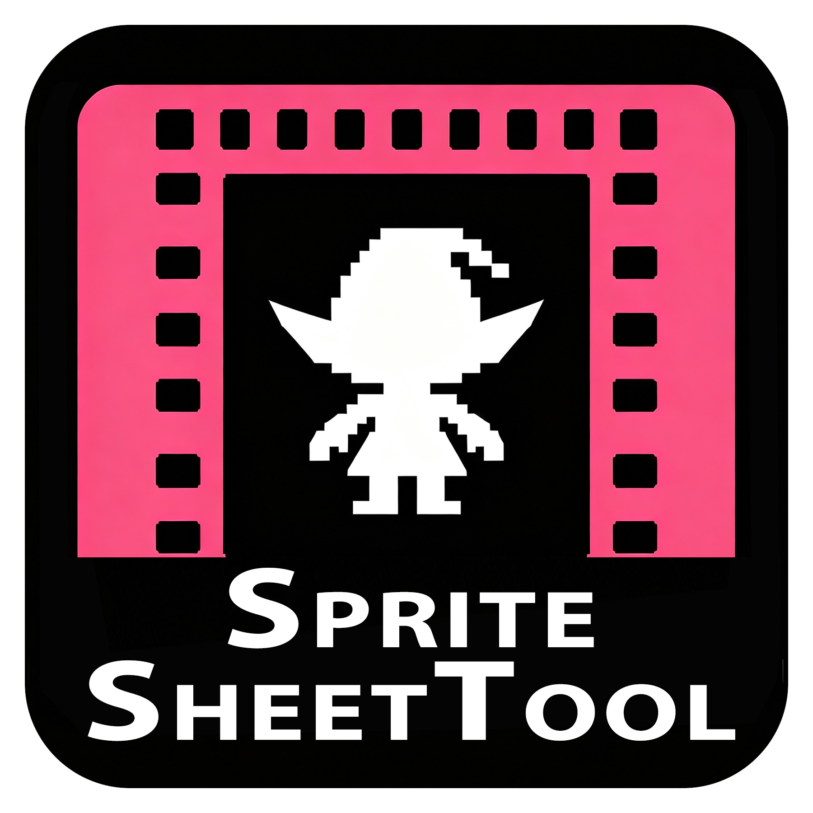
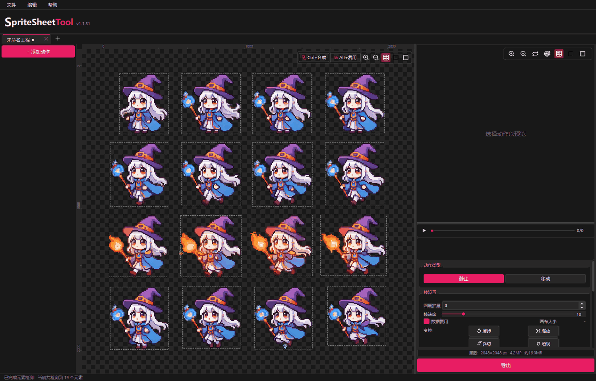
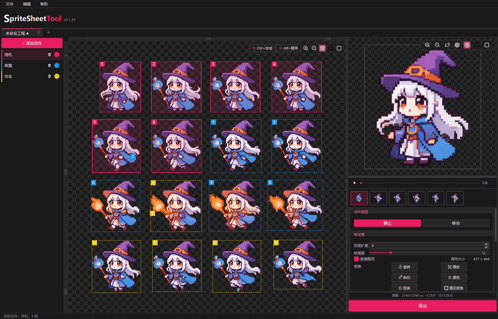
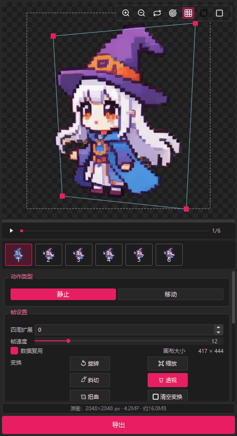
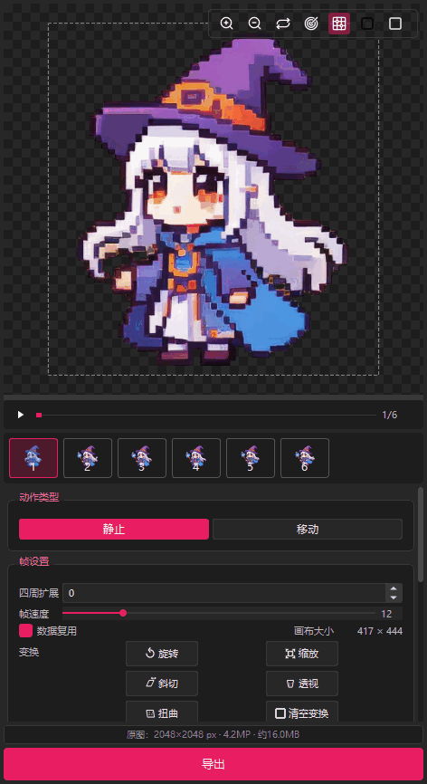

<div align="center">



# SpriteSheetTool · 精灵图动画工作流

**把零散精灵图，做成引擎直接能播的动画。**

[](https://github.com/dzf466628/SpriteSheetTool/releases)
[](LICENSE)
[](https://www.python.org/)
[]()
[]()
[](https://duadu.cc)

<sub>一个编程小白用AI捣鼓出来的工具，代码可能稀烂但真心好用 · 觉得有用点个 ⭐ Star</sub>

</div>

SpriteSheetTool 是一款精灵图自动检测、动作编排、自由变换与动画预览工具。自动识别透明元素、按动作逐帧编排，自由变换每一帧，实时预览，一键导出图集 PNG / GIF / 多格式 JSON。AI、Godot、Phaser、Unity、PixiJS、Cocos2d-x 全链路打通。

还在手动裁切每一帧？动作名和文件名对不上？引擎里动画总是跳？打开 SpriteSheetTool，**一次整理，直接交给引擎。**

---

## 核心能力

### v1.1.49 更新

- MCP 工具扩展到 35 个：新增自动对齐、画笔 / 橡皮、智能抽帧（四档相似度去重）、动作级批量变换，以及动图文档操作链的删除与重排。
- 智能抽帧按相似度分组（同组号 + 帧序相邻为一串，必留最标准那帧），保留帧的落点自动补偿，抽完画面不位移。
- 自动对齐复刻软件的三条路：均分格精确、原图锚点精确，以及帧间重合度估算（估算默认关闭，需显式开启）。

### v1.1.48 更新

- 修复 MCP 客户端关闭连接时打包版因 `BrokenPipeError` 弹出未处理异常窗口。
- 完善动图文档笔刷操作校验，空笔刷路径和非法坐标会返回可读的 MCP 工具错误。

### v1.1.47 更新

- 补充 MCP 创建工程的明确操作引导：创建工程 → 创建动作 → 添加帧；内部布局字段由服务器自动维护。

### v1.1.46 更新

- 修复 MCP 握手版本误报为 SDK 的 `1.30.0`，现在服务端正确报告 SpriteSheetTool 版本。
- 修复 MCP 创建的工程打开时报 `int(None)`，导致动作无法加载的问题。

### v1.1.45 更新

- MCP 工具扩展到 35 个，覆盖工程创建、动作与帧编辑、源图管理、抠图、动图文档和完整导出，并新增自动对齐、画笔擦除、智能抽帧、动作级批量变换与动图文档操作链编辑。
- 抠图保留传统色键与卡通背景两种模式，支持 MCP headless 操作和操作链重放。
- 补齐多部件帧导入、TexturePacker / Aseprite / 本工具 JSON、GIF、逐帧 PNG 导出。
- 修复 Windows 打包版 Qt DLL 加载和 MCP 无界面启动问题。

### 自动检测，快速建立帧

载入图片后基于 Alpha 通道做连通域分析，毫秒级识别每个独立精灵并画出辅助框。点击即加入当前动作，框选可批量建立帧序。

- 辅助框实时显示，避免漏选误选
- 支持多张原图纵向追加，统一编排
- Ctrl 点击把多个元素合成为一帧



### 动作编排与帧复用

每个动作独立保存选中元素、帧序、颜色与全部动画参数，切换动作不丢失；同一个元素可以同时属于多个动作、多次出现在帧里。

- 24 色动作卡牌，帧序即选中顺序
- Alt + 点击复用同一元素，色块标注帧号
- 多工程标签页，各自撤销栈互不干扰



### 五种自由变换，逐帧所见即所得

在预览画布上直接拖拽手柄，对每一帧独立做旋转、缩放、斜切、透视与扭曲；点击空白或按 Esc 退出，结果实时反映在动画里。

- 旋转 / 缩放 / 斜切 / 透视 / 扭曲
- 水平、垂直镜像，自定义旋转中心
- 变换结果缓存，拖动编辑不卡顿



### 预览，就是最终结果

所有帧居中叠放播放，画布取最大帧并保留安全边距。导出前就能发现跳帧、锚点错位等问题，不用反复进引擎调试。

- FPS 1–60，循环 / 单次 / 往返三种模式
- 洋葱皮参照帧、地面线、锚点准星
- 静止 / 移动动作类型，逐帧微调偏移



### MCP 服务器：让 AI 直接读写精灵图工程

内置 headless MCP Server，通过 stdio 传输，让 Claude Desktop / Cursor 等 MCP 客户端直接读写精灵图工程——不用打开软件，AI 自己就能导入、查看、导出。

- 导入精灵图 JSON、读 .sstool 工程元信息
- 列出 / 细看动作、导出引擎 JSON
- 取任意帧的 PNG 预览（base64，AI 能直接看图）
- 创建工程、编排动作和逐帧参数，执行抠图与完整资源导出
- 全程无 GUI，图片用 Pillow 编解码，不依赖 Qt

---

## 抠背景：精灵图去底色

为游戏精灵图和 AI 生成的关键帧去除纯色或单调渐变背景。基础色键和卡通背景 profile 通过同一套参数面板按需切换。

| 参数 | 说明 |
|------|------|
| **容差 tolerance** | 每通道差值 ≤ 容差就算背景，用"最大通道差"而非欧氏距离，用户能自己心算 |
| **软边 soft** | 容差之外再留一段做 alpha 渐变，0 = 硬边 |
| **只清边缘 edge_only** | 只清"与图片边缘连通"的背景，保护角色内部的同色像素（白衣服、眼白、高光），默认开 |
| **收缩 shrink** | alpha 收缩 / 扩张 N 像素，正数 = 收缩（腐蚀，去残留白边），负数 = 扩张 |
| **去溢色 despill** | 半透明边缘里混进来的背景色做 un-premultiply 减掉 |
| **抠图模式** | 基础色键、卡通背景 profile |
| **明暗差上限** | 控制绿幕/蓝幕阴影的清除范围，避免主体灰色区域被误删 |

基础色键适合实时预览；卡通背景 profile 使用 `numpy` 自动保护黑线和主体颜色，不需要额外模型文件。

---

## 导入与还原

把导出的 JSON 还原成软件工程，支持四种格式自动识别（无需用户选择），拖入单个 JSON 即可。

| 格式 | 还原程度 | 说明 |
|------|----------|------|
| **本工具格式** | 完整还原 | 合成帧 parts、fps、loop、锚点、画布留白 padding、地面线、动作类型与移动参数、动作配色、各帧在画布中的落点——唯一无损往返格式 |
| **TexturePacker JSON-Hash / Array** | 部分还原 | 还原图块、动作分组、逐帧落点（由 spriteSourceSize/sourceSize 反推），fps/loop/锚点/地面取默认值 |
| **Aseprite JSON-Array** | 部分还原 | 还原图块、动作分组、fps（由 duration 反推）、loop（由 direction 推）、逐帧落点，锚点取默认值 |

---

## 导出格式

| 格式 | 说明 |
|------|------|
| **图集 PNG** | 原图坐标图集，或去重打包的重构图集，收紧空白、正式发布更省体积 |
| **本工具 JSON** | 保留完整动画与变换上下文，直接发给 AI 分析或生成接入代码 |
| **GIF 预览** | 保留 FPS、循环模式与帧顺序，方便策划、程序快速验收 |
| **引擎 JSON** | Aseprite JSON-Array、TexturePacker Hash / Array，按引擎选择 |
| **.sstool 工程** | 本身是一张 PNG，双击即可打开恢复全部动作、帧与变换 |
| **分别导出** | 每个动作一个文件夹，以工程名开头，反复导出互不覆盖 |

---

## 引擎适配

| 用途 | 格式 | 适用引擎 |
|------|------|----------|
| **AI / 原始数据** | 本工具原始 JSON | 直接发给 AI 理解资源结构、生成接入代码 |
| **Godot / Phaser 3 / Unity** | Aseprite JSON-Array | 导入器读取 frameTags，按标签自动生成动画 clips |
| **PixiJS / Phaser 2 / Cocos2d-x** | TexturePacker Hash / Array | 引擎侧按帧名前缀分组，Hash 便于名称查询，Array 便于顺序遍历 |

---

## 四步完成第一套动画

| 步骤 | 动作 | 说明 |
|------|------|------|
| **1** | 添加精灵图 | 点击「添加图片」或把 PNG 拖入原图区，工具读取透明通道，自动检测并框出每个独立元素 |
| **2** | 创建动作 | 新建待机、行走、攻击等动作卡牌，点击或框选元素组成帧序，每个动作独立保存 |
| **3** | 变换与预览 | 拖拽手柄做旋转、缩放、透视等自由变换，设置 FPS、循环、锚点、地面线，实时确认播放效果 |
| **4** | 选择并导出 | 导出图集 PNG、GIF、本工具 JSON 或引擎专用 JSON，以及可双击恢复的 .sstool 工程文件 |

---

## 快速开始

### 从源码运行

```powershell
python -m pip install -r requirements.txt
python main.py
```

### 启用 MCP 服务器

```powershell
# 开发环境
python -m spritesheet.mcp_server

# 打包版
SpriteSheetTool.exe --mcp
```

### 下载安装包

前往 [软件官网](https://duadu.cc/app/SpriteSheetTool/index.html) 获取最新 Windows 安装包。

安装包面向 Windows 10 / 11 64 位，免运行时，安装即用。

---

## 常见问题

<details>
<summary><b>为什么动画进引擎后会跳动？</b></summary>

优先检查动作的画布尺寸、锚点和逐帧偏移是否统一。预览区打开锚点准星和地面线即可快速定位，也可用洋葱皮参照帧对比相邻帧。

</details>

<details>
<summary><b>自由变换会改动原图吗？</b></summary>

不会。旋转、缩放、斜切、透视、扭曲都作用在帧预览与导出结果上，每帧独立、可随时清空，原图保持不变；工程文件里会保存变换参数。

</details>

<details>
<summary><b>同一个元素能在多个动作里复用吗？</b></summary>

可以。一个元素可同时属于多个动作，也能用 Alt + 点击在同一动作里多次复用为不同帧，元素左上角会按帧号显示色块。

</details>

<details>
<summary><b>.sstool 工程文件是什么？</b></summary>

它本质上是一张 PNG，内部封存了完整工程，双击即可重新打开恢复全部动作、帧序与变换，方便归档和交接。

</details>

<details>
<summary><b>Godot、Phaser 3、Unity 选什么格式？</b></summary>

选择 Aseprite JSON-Array，导入器直接读取 frameTags 生成动画；PixiJS、Phaser 2、Cocos2d-x 则选 TexturePacker Hash 或 Array。

</details>

<details>
<summary><b>本工具原始 JSON 是做什么的？</b></summary>

它是 SpriteSheetTool 的完整资源描述，主要用于直接提供给 AI 理解动作、帧、锚点、偏移与变换，并不是某个引擎的专用导入格式。

</details>

<details>
<summary><b>抠背景和 KeyFrame 有什么区别？</b></summary>

SpriteSheetTool 保留了原来的分块抠图、撤销和实时预览流程，并接入 KeyFrame 的卡通背景 profile。基础色键适合纯色背景，卡通 profile 适合带黑线和抗锯齿边缘的关键帧。

</details>

---

<div align="center">


**[duadu.cc](https://duadu.cc)** · 软件官网：[SpriteSheetTool](https://duadu.cc/app/SpriteSheetTool/index.html) · [GitHub](https://github.com/dzf466628/SpriteSheetTool)

如果这个工具对你有帮助，点个 ⭐ **Star** 支持一下吧！
邮箱 3140992714@qq.com · 微信 vime1230 · 欢迎聊天交流


本软件以 **GNU GPL v3** 开源，可自由使用、修改与再分发。改了啥好玩的欢迎告诉我一声。

</div>

---

## 遥测说明

> 做遥测就俩原因：看看有没有人用，顺便看看哪个功能该砍。有人用我就挺开心的。有bug或者想聊天，邮箱甩过来。

本软件包含匿名使用统计上报，用于了解功能使用情况以改进产品。

**上报内容（均已脱敏）：**
- 软件版本号
- 功能使用计数（仅功能名 + 次数，不含文件名、路径、素材内容）
- 脱敏机器标识（MAC + 硬盘序列号经 SHA256 哈希取前 16 位，不可逆）
- 本机 IP 前三段（如 `192.168.0.*`）

**不上报：** 任何用户文件、路径、素材内容、个人身份信息。

**关闭方式：** 设置环境变量 `HTSJ_DISABLE=1` 即可完全关闭遥测。
